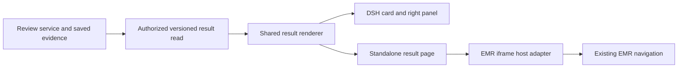

# Structured clinical result viewer V1

English | [中文](clinical-result-viewer-v1.zh.md)

Status: implementation in progress under the confirmed V1 scope and approved development-directory extension. Deployment, real EMR navigation, and user acceptance remain unverified. The existing [pre-discharge review](drg-review-assistant-v1.md) remains the business baseline; its [plugin design](drg-review-assistant-v1-plugins.md) owns evidence collection and calculation responsibilities.

## Summary

Doctors open a saved review result from a chat card or an EMR sidebar, inspect findings and their evidence, and navigate to the relevant EMR record. Both entries display the same structured result and version. Opening a result does not run the model again or require the original chat to be open.

The first delivery supports advisory pre-discharge review. It preserves company SSO, the configured company model, private user workspaces, replaceable encounter readers, and discharge without blocking. Document generation, clinical writeback, human coding confirmation, and DRG/DIP engines remain separate work.

## Table of Contents

- [Users and scope](#scope)
- [User flow and presentation](#flow)
- [Identity and structured information](#information)
- [Actions and status](#actions)
- [Plugin responsibilities and embedding](#plugins)
- [Behavioral requirements](#requirements)
- [Acceptance scenarios](#acceptance)
- [Compatibility and delivery boundaries](#compatibility)
- [Dependencies and review points](#dependencies)
- [Dev Note](#dev-note)

## Users and scope

Doctors need a stable result they can reopen while working in EMR. EMR integrators need typed result references and a bounded action registry, rather than parsing natural-language advice. Operators retain responsibility for identity mapping, encounter authorization, source versions, and the existing model configuration.

| Decision | V1 requirement |
| --- | --- |
| Confirmed direction | Separate the chat process, saved structured result, and result presentation. Deliver an independently embeddable viewer through DSH plugins. |
| First result type | Pre-discharge review, including cited findings, coverage, limitations, and independent DRG/DIP availability. |
| Two entry points | A result card in DSH opens the right panel; a standalone result page supports an EMR iframe. They reuse the same renderer and authorized result data. |
| Proposed first actions | View the saved evidence, open a mapped EMR record, locate a supported field or section, and request review again. No record content is modified. |
| Existing isolation | Results remain private to the authenticated account and authorized encounter. Shared national references remain read-only. |
| Bounded conversation work | Keep the current encounter launch rule for V1. The data model distinguishes encounters, Sessions, and results without redesigning the chat list or adding multi-task Session creation. |
| Approved development directory | Select a permitted department and load its current inpatients in the sidebar. Selecting a patient opens its encounter and saved results without starting review. |

V1 excludes generating admission/discharge documents, automatically changing diagnoses or codes, submitting claims, saving or signing EMR records, a hospital-wide shared issue list, new grouping engines, and a new clinical approval process. Personal disposition buttons and cross-user collaboration need a separate lifecycle specification; V1 retains “pending human review” instead of offering a misleading “resolved” button.

### Approved development-directory scope

The user approved the `emr_app` `pg_develop` development database, hospital `1001`, source `emr-pg-develop`, and the current approved test encounter’s department, 测试科室 (`99999`), for the existing approved SSO account. This grants that account the department’s valid current inpatients with source state `4` or `5`; it grants neither all-hospital browsing nor another account or environment. The operator-owned policy binds the issuer, subject, source, hospital, and department and replaces the corresponding exact test-encounter grant. Every directory read, launch, saved-result read, and review checks the relevant permission; transfer, discharge, or revocation ends department access.

Directory rows contain only the encounter identity, patient name, and bed. Department selection, pagination, search, and patient selection do not create a model request or automatic review. Switching patients clears the prior selection and invalidates pending result requests. Department permission checks require current admission data and fail closed when that source is unavailable; this is separate from recapturing evidence or comparing freshness.

Success means the same saved result is readable through both entry points, its evidence is identifiable, supported actions reach the correct encounter and location, unsupported actions explain their limitation, and failures never affect the EMR discharge transaction. A useful review is not a medical-clearance or payer-approval certificate.

## User flow and presentation

The result is a saved business artifact. Chat messages explain the work; the result view presents the accepted report fields. The viewer does not extract a new result from the assistant's final Markdown or request another model summary.

1. The existing authenticated entry binds the encounter and starts an explicit review request. Opening an encounter or a saved result alone does not start review.
2. Once a report is durably saved, the chat displays a result card with result type, encounter label, generation time, revision, finding count, and coverage warning. The card opens that exact revision.
3. The viewer shows encounter and version context, the review summary, findings, original evidence, coverage gaps, and calculation availability. Each finding separates the observed discrepancy, supporting evidence, and suggested next step.
4. The doctor expands saved evidence locally or explicitly opens a supported EMR location. The latter displays the current EMR record and may differ from the saved evidence.
5. After editing in EMR through its existing controls, the doctor can request review again. A new accepted report creates a new revision; the previously opened result stays visible until the doctor selects the new one.

| Area | Required information and behavior |
| --- | --- |
| Header | Authorized encounter label, result type, generation time, evidence capture/cutoff time, revision, historical/current selection, and source freshness. |
| Summary and findings | Finding count, finding classification, explanation, suggestion, evidence links, and supported actions. Zero findings means only that this review reported none. |
| Evidence | Exact saved quotation with source identity, revision, record status, and available location; original evidence and model explanation have distinct labels. |
| Coverage | Reviewed and unreviewed inventory, unread/unsupported/unavailable categories, and explicit acquisition failures. No unread source is presented as an absent clinical fact. |
| Calculation | DRG and DIP remain separate. Current unavailable calculations display their reason; neither an inferred group nor a score is invented. |
| Version and progress | A history selector and a separate new-review progress indicator. A failed or cancelled new run does not erase the last saved result. |
| Empty or failed view | Distinguish no report yet, loading, access denied, authentication required, missing result, unsupported schema, and recoverable read failure. Do not display a blank success page. |

The iframe layout must be usable at a 360 CSS-pixel sidebar width and a 1024 CSS-pixel full-page width without horizontal page scrolling. Evidence expands without losing the selected finding. Keyboard navigation, visible focus, locale-owned text, and non-color status labels apply to both hosts.

## Identity and structured information

The following are required business meanings and proposed stable key names. Wire types and storage migrations belong to the implementation design. Identifiers are opaque, server-owned values; UI labels are never identifiers. A source-system visit number is not interchangeable with an EMR internal inpatient ID.

| Field or record | Meaning and invariant |
| --- | --- |
| schemaVersion / resultType | Version the readable result format independently of its content revision. V1 supports pre-discharge review; unknown formats/types produce an explicit unsupported state. |
| encounterRef | A verified source-system and hospital-scoped encounter reference. All result, evidence, and action targets belong to this binding. |
| sessionId | The originating private Session. One Session keeps one encounter; an encounter may have multiple task Sessions in a later integration. V1 does not change the existing launch selection rule. |
| resultId / revision | A logical result identity and an immutable accepted revision. Links select both, with an owning Session reference where required. The adapter preserves existing immutable reportId values as source identities. |
| generatedAt / evidenceRevision / capturedAt / cutoff | Identify when the report was produced and which accepted evidence snapshot it used. Generation time does not establish source freshness. |
| findingId | A server-assigned finding instance within a result revision. Rechecking does not silently copy a previous finding's resolution or identity by title similarity. |
| issueCode | A registered problem category, separate from findingId, localized text, and ICD codes. Model proposals must validate against the supported registry. |
| fieldKey | An optional semantic clinical location, independent of an EMR template's display label. Missing or unsupported mappings retain readable findings without a locate action. |
| evidenceRefs | References to exact source content and revision used for the finding, including quotation and validated positions. They do not establish an EMR editor cursor location. |
| targetRef | A separately validated EMR record/section target with available record revision and field mapping. The record supporting a finding can differ from the record to edit. |
| actionKey / action parameters | A registered action and bounded parameters, selected only when the host declares support and the target is validated. No arbitrary URL, script, SQL, or DOM selector is executable output. |
| review / coverage / freshness / calculation | Separate states for report production, evidence coverage, source comparison, and each calculation mode. They are not combined into one “passed” flag. |

For V1, one pre-discharge review task in a Session keeps one logical resultId across reruns; every accepted report receives a new increasing revision. Existing reportId values remain exact identifiers for their original report content. Freshness checks and UI progress are separate read metadata and do not mutate an accepted report revision.

The initial issue registry distinguishes cross-record inconsistency, potentially missing documented information, and a question requiring clinician verification. An unmapped legacy finding retains its original classification and text with an explicit legacy marker; it does not acquire a guessed clinical rule code.

Proposed field keys include `diagnosis.principal`, `diagnosis.secondary`, `procedure.performed`, and `document.discharge_summary`. These identify business meaning, not an instruction to change those fields. A trusted adapter maps them to supported EMR fields; a missing mapping must not fall back to title matching or a guessed record.

Historical results resolve evidence from their original accepted snapshot. The saved quotation remains available even if EMR changes; if the retained source cannot be recovered, the viewer shows the available quotation with an explicit missing-source warning. It never substitutes the latest snapshot under an old citation.

## Actions and status

The first action set is deliberately limited to inspection, navigation, and requesting another review. The result service validates proposed targets; the EMR adapter checks its current encounter and capabilities immediately before executing a navigation request.

| Proposed actionKey | Owner | Completion means |
| --- | --- | --- |
| evidence.view_snapshot | Viewer | The saved evidence for this result revision is displayed. No EMR navigation is implied. |
| emr.open_record | EMR adapter | The specified supported record is open for the same encounter. It is not necessarily the historical revision used in review. |
| emr.focus_field | EMR adapter | The correct record is open, its editor is ready, and the mapped field is focused. Unsupported editor types return unsupported. |
| emr.open_section | EMR adapter | A registered existing diagnosis, order, or coding section is open. V1 enables only sections verified by the integration. |
| review.rerun | Review service | An authenticated, idempotent review request is accepted. Completion of analysis is reported separately. |

An action request binds protocol version, requestId, view instance, encounterRef, resultId/revision, findingId where applicable, actionKey, and validated target parameters. Replies preserve that correlation and distinguish completed, unsupported, denied, cancelled, failed, and unknown outcome. Within a still-authorized scope, the same ID and parameters return the saved receipt without repeating execution; the same ID with different parameters is rejected. Expired-view messages remain invalid. Timeouts do not imply success and must not trigger blind retries.

| State | What the user can infer |
| --- | --- |
| Report generated | The model proposal is durably available and pending human review. |
| Navigation completed | The EMR adapter reached the requested location; no content was saved or confirmed. |
| EMR content saved | Only an actual EMR save receipt can establish this; V1 does not infer or own this state. |
| Finding resolved | V1 does not offer this assertion. A later disposition/recheck specification must distinguish clinician judgment from a new model assessment. |
| Sources unchanged / changed / unknown | Compare the complete accepted evidence inventory and revisions, including added/deleted sources and acquisition coverage, against a reliable provider revision or equivalent digest. Show lastCheckedAt and comparison scope; partial comparison cannot establish that the entire encounter is unchanged. |

Reading a saved result does not initiate a source comparison. Before a comparison, freshness is unknown; an earlier comparison is labeled with its time rather than presented as live synchronization. Explicit refresh/rerun can establish a new comparison. Changed evidence creates a new review basis without rewriting the old result.

Historical, changed-source, and unknown-freshness results remain readable with clear labels. A revision-dependent field action is unavailable when its target cannot be matched safely; opening a validated current record may remain available with an explicit current-record label. Rerun performs the existing refresh and review checks under current authorization.

## Plugin responsibilities and embedding

This feature uses existing Cordis extension points. It does not change the agent loop or turn clinical output into global shared context. The independent page is a route of the supported DSH Web profile, not a new package binary or separately launched agent application.

| Responsibility | Required ownership |
| --- | --- |
| Review producer and saved result reader | The clinical review service owns accepted reports, evidence revisions, authorized reads, and rerun admission. A versioned read projection supplies the viewer without invoking the model or re-collecting clinical data. |
| Result presentation plugin | A registered Client plugin renders structured findings, evidence, coverage, and actions. It contributes the chat card and right-panel entry through existing UI extension points. |
| Standalone result page | Hosts the same renderer and result reader without requiring a chat page to mount first. It adapts authentication, result selection, and embedding lifecycle without duplicating review state. |
| EMR host adapter | Maps approved semantic keys to actual EMR navigation capabilities; validates the active encounter, acknowledges actions, and manages patient-switch cancellation. It does not copy the review engine into EMR. |

Embedding uses a versioned handshake with exact allowed origin and parent/opener identity, followed by a selected result reference and host capability declaration. An encounter-only launch may list only the current user's authorized results and requires selection when more than one exists; it must not silently open another doctor's result or switch the selected revision.

Messages carry bounded references, action requests, and correlated receipts. Clinical report bodies are fetched through the authenticated result API, not broadcast through window messages. Model keys, owner credentials, database credentials, and login bearer tokens do not appear in URLs, messages, or model context. SSO establishes identity; the service separately checks ownership and encounter authorization on reads and actions.

A parent patient switch or account change immediately clears the old view and invalidates outstanding request correlations. Late responses remain associated with the original encounter and cannot repaint the new one. An iframe reload requires a new handshake; unknown message types or unsupported protocol versions cannot execute actions.

Actual SSO, frame policy, cookie behavior, and reverse-proxy origins require browser verification with EMR. If login cannot run inside a frame, the user completes the configured top-level SSO flow and returns to a fresh handshake. The integration does not weaken origin checks, frame policy, or authorization to make the iframe load.

## Behavioral requirements

These requirements define the first delivery. The acceptance table maps them to observable scenarios; broader clinical requirements remain in the existing review PRD.

| ID | Requirement |
| --- | --- |
| RV-01 | Publish a card only after the result is durably accepted; open the selected immutable revision through both hosts without another model request. |
| RV-02 | Distinguish encounter, Session, logical result, report revision, and finding identity; validate every lookup and target against their owner. |
| RV-03 | Return typed, versioned results from saved state without parsing chat Markdown or recapturing live clinical evidence. Required current permission checks remain independent. Unknown formats are visibly unsupported. |
| RV-04 | Show original evidence, coverage gaps, capture/cutoff times, and separate DRG/DIP availability; never infer full review from a zero-finding report. |
| RV-05 | Keep historical report-to-evidence bindings intact, make freshness explicit, and prevent late or superseded work from replacing the selected result. |
| RV-06 | Offer only registered actions with validated targets and declared host support; every navigation request is checked against the current encounter. |
| RV-07 | Correlate action receipts, return saved receipts for valid identical retries, reject conflicting or obsolete requests, and distinguish accepted work, navigation success, clinical decisions, and unknown outcomes. |
| RV-08 | Reuse one result renderer in the DSH panel and independent page, including narrow layout, keyboard operation, localization, and failure states. |
| RV-09 | Apply authenticated owner and encounter checks to every result read and action; a copied link grants no access to another user. |
| RV-10 | Validate embedding origin, window identity, protocol version, capabilities, and lifecycle; clear stale content on patient/account switch or authentication loss. |
| RV-11 | Make rerun explicit and idempotent, retain the prior result on failure, and never wait for review in the discharge transaction. |
| RV-12 | Display existing reports through a documented compatibility projection, preserve their IDs/content, and mark unavailable metadata/actions without fabricating them. |
| RV-13 | Browse only the approved account/source/hospital/department scope, with bounded minimal inpatient pages. Patient selection never triggers review; current permission, transfer, discharge, and revocation checks apply to subsequent reads and actions. |

## Acceptance scenarios

Use synthetic records for repeatable fixtures and the already authorized company pilot for live integration. A successful model response, screenshot, or document check alone is not clinical or EMR integration acceptance.

| Scenario | Requirement | Observable result |
| --- | --- | --- |
| Open a saved result from its chat card, then in a standalone page after closing chat. | RV-01, RV-03, RV-08 | Both show identical result/revision and evidence; no model call or clinical re-collection occurs. |
| Open the same result while the clinical data provider is unavailable but authorization remains verifiable. | RV-03, RV-05 | Saved data remains readable; source freshness is unknown and acquisition failure does not erase the report. |
| Review reports with zero findings, unread sources, unsupported categories, and unavailable calculations. | RV-04 | Coverage and separate calculation limits remain visible; no whole-case pass appears. |
| Refresh the encounter after a report, then open its older revision. | RV-02, RV-05 | The older report shows its original evidence and historical label, not the new snapshot's content. |
| Keep all quotations unchanged but add/delete another source or change acquisition coverage, then compare freshness. | RV-04, RV-05 | A complete comparison detects the change; partial or unavailable comparison cannot report the whole encounter unchanged. |
| Request an unknown schema or load an existing report lacking new keys. | RV-03, RV-12 | Unknown schema is unsupported; legacy content remains readable with limited actions and no invented keys. |
| Click view evidence, open record, and locate field for a verified EMR mapping. | RV-06, RV-07 | Each action performs only its declared behavior on the correct encounter; successful navigation does not resolve a finding. |
| Request an unsupported editor, missing mapping, forged target, or changed target revision. | RV-06, RV-07 | The action is unavailable or rejected with a reason; there is no guessed navigation or content write. |
| Switch patients while reads/actions are pending; replay the old reply. | RV-05, RV-07, RV-10 | Old content clears immediately and the old reply cannot update or navigate the new patient's page. |
| Use another account's link, a revoked encounter grant, or an expired login. | RV-09, RV-10 | Data and actions are refused; reauthentication cannot reuse the previous account's cached result. |
| Send foreign-origin, wrong-window, malformed, conflicting-ID, or unsupported-version messages; retry a valid identical request and reload the iframe. | RV-07, RV-10 | Invalid messages cannot execute actions; valid identical retries return the saved receipt without re-execution; reload requires a new supported handshake. |
| Repeat one rerun request, then cancel or fail the model/provider while submitting discharge. | RV-07, RV-11 | At most one run is admitted for that request; old results survive, failure is visible, and discharge completes independently. |
| Browse at 360 and 1024 CSS pixels with keyboard-only interaction. | RV-08 | Findings, quotations, controls, and error text remain usable without page-level horizontal scrolling. |
| Restart the private runtime and reopen current and historical result references. | RV-01, RV-05, RV-12 | Saved versions and source identities are restored; missing retained data is reported explicitly. |
| Complete company SSO and use the real EMR iframe with supported navigation. | RV-06, RV-09, RV-10 | Login, authorized read, patient switching, and action receipts work in the deployed origins; a standalone demo alone does not pass this scenario. |
| Select the approved development department, search and page its inpatients, then select a patient. | RV-09, RV-13 | The sidebar shows minimal authorized identities; the selected encounter opens without a model request, and the previous patient’s content is cleared. |
| Forge another hospital or department, switch accounts, transfer or discharge a department-authorized patient, or revoke the grant. | RV-09, RV-10, RV-13 | No directory data, saved result, launch, or review is admitted through the removed scope; no exact test-encounter grant bypasses the department restriction. |

## Compatibility and delivery boundaries

The [saved-result records](../../packages/experimental/clinical-review/src/result.ts) define a versioned reading projection over existing immutable reports. The [HTTP bridge](../../packages/experimental/clinical-review/src/bridge.ts) separates result listing and exact-revision reads from explicit rerun admission. Legacy findings retain their original classification and readable content; no semantic field target or verified EMR navigation mapping is invented.

The [clinicalResults projection](../../packages/experimental/clinical-review/src/result-projection.ts) recovers report-to-snapshot associations from retained Session records. Missing historical metadata remains explicit. Citation offsets always describe the saved source content, never newer text or EMR editor coordinates.

Opening a result without its chat is a navigation requirement, not a new retention policy. V1 uses existing private Session retention; a deleted or unavailable owning Session produces an explicit unavailable result. Archive/reopen behavior must match existing storage semantics. Long-term records independent of Session deletion require a separate retention decision.

Deliver the saved-result read and DSH view first, then the same view as an independent route, then the EMR adapter and real-origin validation. Each stage preserves the existing manual review entry. Disabling the presentation plugin removes its UI without deleting reports or changing discharge behavior. Persistent and public protocol changes require the repository's compatibility review and upgrade documentation.

## Dependencies and review points

The V1 scope and development-directory extension are confirmed. Implementation checks and business acceptance remain separate; the following evidence is required before claiming the corresponding integration works.

| Item | Proposed boundary or required evidence |
| --- | --- |
| First scope | Pre-discharge results, evidence, supported navigation, and explicit rerun; no disposition ledger or clinical writeback. Unverified EMR mappings remain unavailable. |
| Conversation behavior | Preserve the current one-private-review-Session launch selection; support distinct entity IDs and future multi-task relationships without implementing new Session creation in this change. |
| EMR action adapter | Verify the actual record IDs, template-to-field mapping, editor readiness, supported section routes, and result of each action. Unsupported capabilities stay disabled. |
| Login and authorization | Confirm the exact embedding origins, SSO account mapping, frame policy, and server-side encounter permission checks. Real browser evidence is required. |
| Compatibility | Specify legacy result identity mapping, historical snapshot reconstruction, and read schema/version behavior before changing persistence or public APIs. |
| Acceptance ownership | The user reviews the result hierarchy and action scope; an EMR integrator verifies navigation; a clinical reviewer judges usefulness separately from technical checks. |

Saved-result reading, shared views, explicit reruns, and the scoped patient directory are implemented. Root and proxy-prefixed Web scenarios pass, and development database connectivity is verified read-only. The approved development department is the only patient-access extension; no other account, hospital, environment, model provider, or shared-result policy is introduced. Real EMR navigation, iframe/SSO integration, and user and clinical acceptance remain pending. Technical checks do not replace those acceptance decisions.

## Dev Note

The reference interaction is the user-supplied clinical-assistant screenshot: encounter-grouped conversations and a generated-record link. Live access to the reference detail page was not verified; its internal result schema, storage, and cross-conversation memory are not evidence for this design. Existing DSH [deliverable UI extension points](../../packages/client/ui-deliverables/src/client/index.ts) and [EMR browser messages](../../packages/experimental/client-emr-entry/src/client/protocol.ts) provide integration references.
