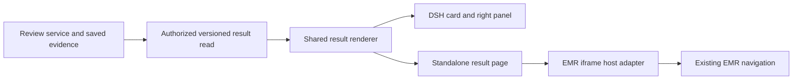

# 结构化临床结果展示 V1

[English](clinical-result-viewer-v1.md) | 中文

状态：正在按已确认的 V1 范围及已批准的开发目录扩展实施。部署、真实 EMR 导航及用户验收尚未验证。既有[出院前核查](drg-review-assistant-v1.zh.md)继续作为业务基线；其[插件设计](drg-review-assistant-v1-plugins.zh.md)拥有取证与计算职责。

## 摘要

医生从聊天结果卡或 EMR 侧边栏打开已保存的核查结果，查看疑点及证据，并进入相关 EMR 记录。两个入口展示同一份结构化结果及版本。打开结果不重新调用模型，也不要求原聊天处于打开状态。

首版支持提示性的出院前核查，保留公司 SSO、已配置的公司模型、用户私有工作区、可替换取数器及不阻断出院。文书生成、临床回写、人工编码确认和 DRG／DIP 引擎仍属其他工作。

## 目录

- [用户与范围](#scope)
- [使用流程与界面](#flow)
- [身份与结构化信息](#information)
- [动作与状态](#actions)
- [插件职责与嵌入](#plugins)
- [行为需求](#requirements)
- [验收场景](#acceptance)
- [兼容性与交付范围](#compatibility)
- [依赖与评审项](#dependencies)
- [开发备注](#dev-note)

## 用户与范围

医生需要在 EMR 工作时能反复打开的稳定结果。EMR 集成人员需要有类型的结果引用与受限动作注册表，不必解析自然语言建议。运维继续负责身份映射、就诊授权、资料版本及既有模型配置。

| 决策 | V1 要求 |
| --- | --- |
| 已确认方向 | 区分聊天过程、已保存的结构化结果、结果展示。通过 DSH 插件提供可独立嵌入的界面。 |
| 首个结果类型 | 出院前核查，包含带引用的疑点、覆盖范围、限制，以及独立的 DRG／DIP 可用状态。 |
| 两个入口 | DSH 结果卡打开右侧面板；独立结果页供 EMR iframe 嵌入。复用同一展示组件和经授权的结果数据。 |
| 建议首批动作 | 查看已存证据、打开已映射的 EMR 记录、定位支持的字段或栏目、请求重新核查。不修改记录正文。 |
| 既有隔离 | 结果仍属于已认证账号及获授权就诊。国家资料继续只读共享。 |
| 有限的会话改造 | V1 保留现有就诊启动规则。数据模型区分就诊、Session 和结果，不重做聊天列表或增加多任务 Session 创建。 |
| 已批准开发目录 | 选择获准科室并在侧栏加载其在院患者。选择患者打开对应就诊和已存结果，不启动核查。 |

V1 不包含生成入院／出院文书、自动修改诊断或编码、医保上报、保存或签署 EMR 记录、全院共享问题清单、新分组引擎，以及新的临床审批流程。个人处置按钮与跨用户协作需要单独约定状态流转；V1 保留“待人工复核”，不提供含义不明的“已解决”按钮。

### 已批准的开发目录范围

用户批准使用 `emr_app` `pg_develop` 开发库、医院 `1001`、来源 `emr-pg-develop`，并将当前已批准测试就诊所在的测试科室（`99999`）授权给既有已批准 SSO 账号。该账号可以访问此科室中来源状态为 `4` 或 `5` 的有效在院患者，不开放全院浏览，也不授权其他账号或环境。运维拥有的策略绑定签发方、主体、来源、医院及科室，并替换对应的精确测试就诊授权。每次目录读取、启动、已存结果读取及核查均检查相应权限；转科、出院或撤权会终止科室访问权限。

目录记录仅包含就诊标识、患者姓名和床位。选择科室、分页、搜索及选择患者均不创建模型请求或自动核查。切换患者会清除前一选择并使未完成结果请求失效。科室权限检查需要当前住院记录，来源不可用时拒绝访问；该检查与重新采集证据或比较新鲜度分别处理。

成功标准是同一份已存结果能从两个入口读取、证据可辨识、支持的动作到达正确就诊和位置、不支持的动作说明限制，并且任何失败都不影响 EMR 出院事务。核查有用不代表医疗放行或医保认可。

## 使用流程与界面

结果是已保存的业务产物。聊天消息说明工作过程，结果界面呈现已接受的报告字段。界面不从助手最终 Markdown 中重新提取结果，也不再请求模型生成摘要。

1. 既有认证入口绑定就诊，并在明确请求后启动核查。单独打开就诊或已保存结果不启动核查。
2. 报告持久化完成后，聊天显示结果卡，包含结果类型、就诊标签、生成时间、修订、疑点数和覆盖提示。卡片打开该确切修订。
3. 结果界面显示就诊及版本信息、核查摘要、疑点、原文证据、覆盖缺口和计算可用性。每个疑点区分观察到的不一致、支持证据和建议操作。
4. 医生在界面内展开已保存证据，或明确打开受支持的 EMR 位置。后者显示 EMR 当前记录，可能与已保存证据不同。
5. 医生通过 EMR 原有控件修改后，可以请求重新核查。新的有效报告产生新修订；当前打开的结果保留，直到医生选择新版。

| 区域 | 必需信息与行为 |
| --- | --- |
| 顶部信息 | 经授权的就诊标签、结果类型、生成时间、证据采集／截止时间、修订、历史／当前选择，以及来源新鲜度。 |
| 摘要与疑点 | 疑点数、问题分类、说明、建议、证据链接及受支持动作。零疑点只表示本次核查未报告疑点。 |
| 证据 | 已保存的精确引文及来源身份、修订、记录状态和可用位置；原始证据与模型解释有不同标签。 |
| 覆盖范围 | 已核查与未核查目录、未读／不支持／不可用类别，以及明确的取数失败。未读来源不显示成临床事实缺失。 |
| 计算 | DRG 与 DIP 分别呈现。当前计算不可用时显示原因，不编造推测分组或分值。 |
| 版本与进度 | 历史选择器及独立的新核查进度。新一轮失败或取消不清除上一份已保存结果。 |
| 空白或失败状态 | 区分尚无报告、加载中、无权访问、需要登录、结果不存在、格式不支持及可恢复读取失败，不显示空白成功页。 |

iframe 布局在 360 CSS 像素宽侧栏和 1024 CSS 像素宽整页均应可用，不产生页面级横向滚动。展开证据后保留所选疑点。两个容器均支持键盘操作、可见焦点、语言字典文案及不只依赖颜色的状态标签。

## 身份与结构化信息

下表规定业务含义及建议稳定键名。网络类型及存储迁移在实施设计中落实。标识为服务端拥有的不透明值，界面标签不能充当标识。来源系统的就诊流水号不能与 EMR 内部住院 ID 互换。

| 字段或记录 | 含义与不变量 |
| --- | --- |
| schemaVersion / resultType | 结果读取格式单独版本化，与内容修订分离。V1 支持出院前核查；未知格式／类型显示明确的不支持状态。 |
| encounterRef | 经核验且限定来源系统和医院的就诊引用。所有结果、证据及动作目标属于此绑定。 |
| sessionId | 生成结果的私有 Session。一个 Session 固定一个就诊；后续集成允许一个就诊具有多个任务 Session。V1 不改变现有启动选择规则。 |
| resultId / revision | 逻辑结果标识及不可变的已接受修订。链接同时选定两者，必要时携带所属 Session 引用。适配器保留既有不可变 reportId 作为来源身份。 |
| generatedAt / evidenceRevision / capturedAt / cutoff | 标识报告生成时间及其采用的已接受证据快照。生成时间不证明来源仍最新。 |
| findingId | 由服务端分配的结果修订内疑点实例标识。复查不根据标题相似度静默沿用旧疑点的解决状态或身份。 |
| issueCode | 已注册的问题分类，与 findingId、本地化文案和 ICD 编码分离。模型提案须通过支持的注册表校验。 |
| fieldKey | 可选的临床业务语义位置，独立于 EMR 模板显示名。缺少或不支持映射时，保留可读疑点，不提供定位动作。 |
| evidenceRefs | 疑点采用的确切来源内容及修订引用，包括引文和已校验位置。它们不等于 EMR 编辑器的光标位置。 |
| targetRef | 单独验证的 EMR 记录／栏目目标，含可用记录修订及字段映射。支持疑点的记录与需要修改的记录可以不同。 |
| actionKey / action parameters | 已注册动作及有限参数，仅在宿主声明支持且目标已验证时提供。不把任意 URL、脚本、SQL 或 DOM 选择器作为可执行输出。 |
| review / coverage / freshness / calculation | 分别表达报告生成、证据覆盖、来源比较及各模式计算状态，不合并成一个“通过”标志。 |

V1 中，同一 Session 内的出院前核查任务在重新核查时保留逻辑 resultId，每份有效报告产生新的递增修订。既有 reportId 仍精确标识原报告内容。新鲜度检查和界面进度属于独立读取元数据，不修改已接受的报告修订。

初始问题注册表区分跨记录不一致、已记载信息可能遗漏、需医生核实的问题。无法映射的旧疑点保留原分类及正文，并明确标注旧格式，不猜测赋予临床规则编号。

建议字段键包括 `diagnosis.principal`、`diagnosis.secondary`、`procedure.performed` 和 `document.discharge_summary`。这些键表达业务含义，不代表要求修改相应字段。可信适配器将其映射到受支持的 EMR 字段；缺少映射时，不退回标题匹配或猜测记录。

历史结果从原始已接受快照解析证据。EMR 修改后，已存引文仍可阅读；如无法恢复保留来源，界面显示现存引文并明确提示来源缺失，不能把最新快照替换到旧引用下。

## 动作与状态

首批动作限定为查看、导航和请求重新核查。结果服务验证候选目标，EMR 适配器在实际执行导航前检查当前就诊及能力。

| 建议 actionKey | 所有者 | 完成的含义 |
| --- | --- | --- |
| evidence.view_snapshot | 结果界面 | 已显示该结果修订的已存证据，不代表发生 EMR 导航。 |
| emr.open_record | EMR 适配器 | 已打开同一就诊下的指定受支持记录，不一定是核查采用的历史修订。 |
| emr.focus_field | EMR 适配器 | 正确记录已打开、编辑器已就绪、映射字段获得焦点。不支持的编辑器类型返回不支持。 |
| emr.open_section | EMR 适配器 | 已打开注册的既有诊断、医嘱或编码栏目。V1 仅启用集成已验证的栏目。 |
| review.rerun | 核查服务 | 已接受经认证且幂等的核查请求。分析完成通过独立进度呈现。 |

动作请求绑定协议版本、requestId、视图实例、encounterRef、resultId/revision、适用的 findingId、actionKey 及已验证目标参数。回执保留对应关系，区分完成、不支持、拒绝、取消、失败和结果未知。在仍获授权的作用域内，同 ID 同参数返回已保存回执且不重复执行，同 ID 不同参数被拒绝。已失效视图的消息仍无效。超时不代表成功，也不能触发盲目重试。

| 状态 | 用户能据此判断什么 |
| --- | --- |
| 报告已生成 | 模型提案已持久化，仍待人工复核。 |
| 导航已完成 | EMR 适配器到达指定位置，没有保存或确认正文。 |
| EMR 正文已保存 | 只有实际 EMR 保存回执能证明；V1 不推断或拥有此状态。 |
| 疑点已解决 | V1 不提供此断言。后续处置／复查规范须区分医生判断与新一轮模型评估。 |
| 来源未变／已变／未知 | 将完整已接受证据目录及修订（含新增／删除来源和取数覆盖）与可靠的提供方修订或等价摘要比较。显示 lastCheckedAt 及比较范围；部分比较不能证明整个就诊未变。 |

读取已保存结果不启动来源比较。尚未比较时，新鲜度为未知；既往比较标注时间，不显示成实时同步。明确刷新／重新核查可产生新的比较。证据变化产生新的核查依据，不重写旧结果。

历史、来源已变及新鲜度未知的结果仍可阅读，并清晰标注。无法安全匹配目标时，依赖修订的字段动作不可用；打开经验证的当前记录可以保留，但须明确标注为当前记录。重新核查按现有流程刷新并核查，使用当前授权。

## 插件职责与嵌入

本功能使用既有 Cordis 扩展点，不修改智能体循环，也不把临床输出变成全局共享上下文。独立页面是受支持 DSH Web profile 的路由，不是新的包命令或单独启动的智能体应用。

| 职责 | 必须明确的所有者 |
| --- | --- |
| 核查结果生产与保存结果读取 | 临床核查服务拥有已接受报告、证据修订、授权读取及重新核查受理。版本化读取投影为界面提供数据，不调用模型或重新采集临床资料。 |
| 结果展示插件 | 注册的 Client 插件展示结构化疑点、证据、覆盖和动作，通过既有 UI 扩展点提供聊天结果卡和右侧面板入口。 |
| 独立结果页 | 挂载相同展示组件及结果读取能力，不要求先挂载聊天页。适配认证、结果选择和嵌入生命周期，不复制核查业务状态。 |
| EMR 宿主适配器 | 将已批准的语义键映射到真实 EMR 导航能力，验证当前就诊、回报动作结果，并在患者切换时取消旧请求。不把核查引擎复制到 EMR。 |

嵌入采用版本化握手，校验精确允许来源及 parent/opener 身份，再传递所选结果引用和宿主能力声明。仅含就诊的启动请求只能列出当前用户有权访问的结果；多份结果时要求选择，不静默打开其他医生的结果或切换已选修订。

消息携带有限引用、动作请求及对应回执。临床报告正文通过经认证的结果 API 读取，不通过窗口消息广播。模型 Key、owner 凭据、数据库凭据及登录 bearer token 不进入 URL、消息或模型上下文。SSO 确定身份，服务端另行对每次读取和动作检查所有权及就诊权限。

父页面切换患者或账号时立即清除旧视图，并使未完成请求的对应关系失效。迟到响应仍属于原就诊，不能重新绘制到新患者页面。iframe 重载后必须重新握手；未知消息类型或不支持的协议版本不能执行动作。

真实 SSO、嵌入策略、Cookie 行为及反向代理来源须在 EMR 中进行浏览器验证。如 iframe 内无法登录，用户完成配置的顶层 SSO 流程后返回，并重新握手。不能为了加载 iframe 而降低来源校验、嵌入策略或授权要求。

## 行为需求

以下需求定义首个交付范围，验收表将其映射到可观察场景。更广的临床需求仍由既有核查 PRD 负责。

| ID | 要求 |
| --- | --- |
| RV-01 | 结果持久化接受后才发布卡片；两个容器均可打开所选不可变修订，不产生额外模型请求。 |
| RV-02 | 区分就诊、Session、逻辑结果、报告修订与疑点身份；每次查找和目标都核对所属关系。 |
| RV-03 | 从已存状态返回有类型且版本化的结果，不解析聊天 Markdown，也不重新采集实时临床证据；必要的当前权限检查独立进行。未知格式明确显示不支持。 |
| RV-04 | 展示原始证据、覆盖缺口、采集／截止时间及独立 DRG／DIP 可用性；不能从零疑点推断完整核查。 |
| RV-05 | 保留历史报告与证据的绑定，明确来源新鲜度，防止迟到或被替代的任务覆盖所选结果。 |
| RV-06 | 仅提供目标已验证且宿主声明支持的注册动作；每次导航核对当前就诊。 |
| RV-07 | 关联动作回执，对有效相同重试返回已保存回执，拒绝冲突或已失效请求，并区分任务受理、导航成功、临床决策及结果未知。 |
| RV-08 | DSH 面板与独立页面复用一个结果展示组件，包含窄屏布局、键盘操作、本地化及失败状态。 |
| RV-09 | 每次结果读取与动作均检查已认证所有者及就诊授权；复制链接不能授予其他用户访问权。 |
| RV-10 | 校验嵌入来源、窗口身份、协议版本、能力及生命周期；患者／账号切换或认证失效时清除旧内容。 |
| RV-11 | 重新核查须明确请求且幂等，失败保留旧结果，出院事务从不等待核查。 |
| RV-12 | 通过有文档说明的兼容投影展示旧报告，保留其身份和内容，缺失元数据／动作明确标注而非编造。 |
| RV-13 | 仅浏览已批准账号／来源／医院／科室范围，返回有界的最小在院患者分页。选择患者不触发核查；后续读取及动作均检查当前权限、转科、出院及撤权。 |

## 验收场景

可重复 fixture 使用合成记录，真实集成使用已授权的公司试用范围。单次模型成功、截图或文档检查均不能独立证明临床或 EMR 集成通过。

| 场景 | 需求 | 可观察结果 |
| --- | --- | --- |
| 从聊天卡打开已存结果，关闭聊天后再从独立页面打开。 | RV-01, RV-03, RV-08 | 两处结果／修订及证据一致，不调用模型或重新采集临床资料。 |
| 临床取数器不可用但授权仍可核验时打开相同结果。 | RV-03, RV-05 | 已存数据仍可读；来源新鲜度为未知，取数失败不清除报告。 |
| 查看零疑点、未读来源、不支持类别及计算不可用的报告。 | RV-04 | 覆盖及各计算限制仍可见，不显示全病例通过。 |
| 生成报告后刷新就诊，再打开旧修订。 | RV-02, RV-05 | 旧报告显示原始证据及历史标签，不显示新快照内容。 |
| 保持所有引文不变，新增／删除其他来源或改变取数覆盖，再比较新鲜度。 | RV-04, RV-05 | 完整比较能识别变化；部分或不可用的比较不能报告整个就诊未变。 |
| 请求未知格式或加载缺少新键的既有报告。 | RV-03, RV-12 | 未知格式显示不支持；旧报告可读，动作受限，不编造键值。 |
| 对已验证 EMR 映射点击查看证据、打开记录和定位字段。 | RV-06, RV-07 | 各动作只对正确就诊执行声明行为；导航成功不解决疑点。 |
| 请求不支持编辑器、缺失映射、伪造目标或已变更目标修订。 | RV-06, RV-07 | 动作不可用或被拒绝并说明原因，不猜测导航或回写正文。 |
| 读取／动作未完成时切换患者，再重放旧回执。 | RV-05, RV-07, RV-10 | 立即清除旧内容，旧回执不能更新或导航新患者页面。 |
| 使用另一账号链接、已撤销就诊授权或过期登录。 | RV-09, RV-10 | 拒绝数据和动作；重新登录不能复用前一账号缓存结果。 |
| 发送外部来源、错误窗口、错误格式、冲突 ID 或不支持版本的消息，重试有效相同请求并重载 iframe。 | RV-07, RV-10 | 无效消息不能执行动作；有效相同重试返回已存回执且不重复执行；重载后要求重新完成受支持握手。 |
| 重复同一重新核查请求，再在提交出院时取消任务或使模型／取数器失败。 | RV-07, RV-11 | 同一请求最多受理一次；旧结果保留、失败可见，出院独立完成。 |
| 在 360 和 1024 CSS 像素宽度下只用键盘浏览。 | RV-08 | 疑点、引文、控件和错误文案均可用，无页面级横向滚动。 |
| 重启私有运行实例后重新打开当前及历史结果引用。 | RV-01, RV-05, RV-12 | 恢复保存版本及来源身份；保留数据缺失时明确报告。 |
| 完成公司 SSO 并在真实 EMR iframe 执行支持的导航。 | RV-06, RV-09, RV-10 | 在实际来源下完成登录、授权读取、患者切换及动作回执；独立示例页不能单独通过此项。 |
| 选择已批准的开发科室，搜索、分页其在院患者，再选择一名患者。 | RV-09, RV-13 | 侧栏仅显示最小授权身份信息；打开所选就诊不创建模型请求，并清除前一患者的内容。 |
| 伪造其他医院或科室、切换账号、转出或出院一名科室授权患者，或撤销授权。 | RV-09, RV-10, RV-13 | 已移除范围不能受理目录数据、已存结果、启动或核查；精确测试就诊授权不能绕过科室限制。 |

## 兼容性与交付范围

[已保存结果记录](../../packages/experimental/clinical-review/src/result.ts)为既有不可变报告定义版本化读取投影。[HTTP 桥接](../../packages/experimental/clinical-review/src/bridge.ts)将结果列表及精确修订读取与明确的重新核查受理分开。旧疑点保留原始分类及可读内容，不编造语义字段目标或已验证的 EMR 导航映射。

[clinicalResults 投影](../../packages/experimental/clinical-review/src/result-projection.ts)从保留的 Session 记录恢复报告与快照的关联。历史元数据缺失时明确标注。引文偏移始终描述已保存来源内容，不指向更新后的正文或 EMR 编辑器坐标。

不打开聊天也能查看结果是导航要求，不是新的保留策略。V1 使用既有私有 Session 保留机制；所属 Session 已删除或不可用时，结果明确显示不可用。归档／重开行为须符合现有存储语义。脱离 Session 删除而长期保存临床结果，需要另行决定保留策略。

先交付保存结果读取及 DSH 视图，再将同一视图挂载为独立路由，最后对接 EMR 适配器并验证真实来源。每阶段保留现有手动核查入口。禁用展示插件只移除其 UI，不删除报告或改变出院行为。持久化及公开协议变更须经过仓库兼容性审查并补齐升级文档。

## 依赖与评审项

V1 范围及开发目录扩展已确认。实现检查与业务验收分别进行；声称相应集成可用前仍须取得下列证据。

| 项目 | 建议范围或所需证据 |
| --- | --- |
| 首版范围 | 出院前结果、证据、受支持导航及明确重新核查，不包含处置台账或临床回写。未经核实的 EMR 映射保持不可用。 |
| 会话行为 | 保留当前私有核查 Session 的启动选择；区分实体标识并容纳未来多任务关系，本次不实现新的 Session 创建。 |
| EMR 动作适配 | 验证实际记录 ID、模板到字段映射、编辑器就绪状态、支持的栏目路由及动作结果。不支持的能力保持禁用。 |
| 登录与授权 | 确认确切嵌入来源、SSO 账号映射、嵌入策略及服务端就诊权限检查，需要真实浏览器证据。 |
| 兼容性 | 修改持久化或公开 API 前，明确旧结果身份映射、历史快照重建及读取格式／版本行为。 |
| 验收责任 | 用户评审结果层次和动作范围，EMR 集成人员验证导航，临床评审者独立于技术检查判断实用性。 |

已完成保存结果读取、共享视图、明确重新核查及受限科室患者目录。根入口和代理前缀 Web 场景通过，开发库只读连通验证通过。已批准的开发科室是唯一患者权限扩展；未引入其他账号、医院、环境、模型提供方或共享结果策略。真实 EMR 导航、iframe／SSO 集成及用户和临床验收仍待完成。技术检查不替代这些验收判断。

## 开发备注

交互参考为用户提供的临床助手截图：按就诊分组的聊天及生成记录链接。参考系统的实时详情页未验证，其内部结果格式、存储及跨会话记忆不作为本设计的证据。既有 DSH [交付物 UI 扩展点](../../packages/client/ui-deliverables/src/client/index.ts)及 [EMR 浏览器消息](../../packages/experimental/client-emr-entry/src/client/protocol.ts)用于集成参考。
