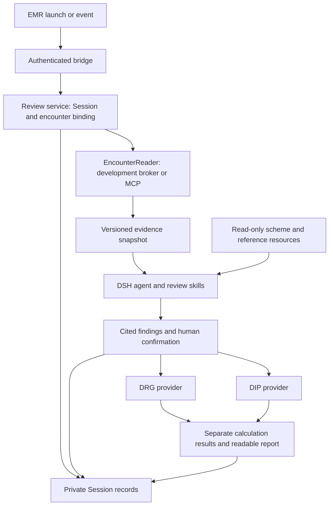

# Pre-discharge review: DRG/DIP plugin design V1

English | [中文](drg-review-assistant-v1-plugins.zh.md)

Status: complete V1 design with a locally verified first-stage subset awaiting user acceptance, 2026-10-22. The user has confirmed pre-discharge review, separate DRG/DIP pre-grouping, and non-blocking discharge. Encounter reading, advisory review, and browser entry form the first subset; structured human confirmation and both grouping engines remain planned. The interfaces below describe the complete target, while the linked package READMEs define current APIs. The [requirements](drg-review-assistant-v1.md) own product scope and acceptance; the [implementation proposal](drg-review-assistant-v1-implementation.md) owns sequencing and existing deployment evidence.

## Summary

One review agent reads encounter evidence, identifies cited discrepancies, collects human decisions, and explains a deterministic result from the appropriate grouping provider. Four business capabilities supply context/evidence, references, review state, and calculation. Skills guide reasoning; code enforces permissions, revisions, confirmation, and rule execution. The clinical record remains owned by EMR, with no writeback in V1.

## Table of Contents

- [Plugin responsibilities](#plugins)
- [Triggers and call order](#triggers)
- [Context and data flow](#context)
- [Business tools and skills](#tools)
- [DRG and DIP calculation](#grouping)
- [Persistence, confirmation, and recovery](#state)
- [EMR data-provider replacement](#providers)
- [Validation and unresolved dependencies](#validation)
- [Dev Note](#dev-note)

## Plugin responsibilities

Names below describe logical modules, not published package names. Keep modules together until ownership or replacement justifies a package split. The reference store is an existing library; adding a model tool requires a plugin consumer. [DSH architecture](../architecture.md) defines Service Definition, Service Provider, and Consumer roles; each proposed replaceable capability includes all three.

| Capability | Owns and supplies | Does not own | Dependencies and replacement |
| --- | --- | --- | --- |
| Encounter context and evidence | An EMR bridge validates launch identity, source identifiers, event IDs, and allowed encounters; an EncounterReader service returns original records and coverage. The bridge requests a binding from the review service. | No second case-state database, grouping rules, clinical confirmation, or database credentials in the model. | Reader definition is independent of the bridge; bounded development reads and a future MCP adapter implement it. The review service consumes the definition, not provider internals. |
| Insurance references | Resolve and validate an explicit scheme/resource binding; read bounded source passages, coding dictionaries, and reviewed rules by stable IDs. | No patient records, payer-mode guessing, publication from agent tools, or model-generated rules. | Reuse the source-only DRG archive; add versioned DIP resources and reviewed executable artifacts separately. Reference tools consume a reader service. |
| Review and confirmation | Own Session/encounter binding, evidence snapshots, findings, human dispositions, per-mode coding snapshots, operation receipts, and result records. Supply business tools and readable reports. | No raw SQL, provider-specific identity shortcuts, clinical-record edits, or payer-approval claims. | Consume reader/reference/grouping service definitions. Use durable plugin records plus Session projections and the root interaction service. |
| Pre-grouping | A grouping service registers separate DRG and DIP providers. Each validates typed inputs and compatible resources and returns its own deterministic result. | No source retrieval, LLM calls, patient authorization, automatic confirmation, or payment calculation. | Business tools consume the service. Pure calculation libraries implement the providers; an external engine adapter requires independently verified version/input semantics. |

The four capabilities do not require four agents. Compose one optional review preset using existing tools, [skills](../../packages/skill/tool-skill/README.md), [human questions](../../packages/interaction/user-questions/README.md), and Session services. Preserve general DSH tools under existing policy. Clinical credentials and broader patient access stay in a controlled server-side reader, so a shell tool cannot bypass patient restrictions by reading a shared credential.

The review service has one canonical state per private runtime and Session. Scoped tools obtain that identity from the live Host/Agent; models cannot choose it. A preset alone does not isolate a Cordis service: use explicit Session keys, or place an entire provider/consumer group in the same isolated realm. The generic gateway supplies authenticated runtime routing; encounter authorization and clinical state belong to the separate broker and review plugins.

## Triggers and call order

Trigger names below are proposed integration events, not verified EMR event names. A manual review action and an authenticated external event enter the same review service. Each event carries a stable event ID and source revision; event deduplication is durable and scoped to the caller, encounter, trigger, and revision. Distinct events for unchanged input reuse the active run or recorded result.

| Time | Server action | Model behavior | Result |
| --- | --- | --- | --- |
| Patient opened | Verify launch and bind/open the encounter-specific Session; publish identity and coverage metadata only. | No wake-up or automatic full review. | Correct patient/encounter and applicable scheme are visible. |
| Manual check or configured discharge-order event | Validate event, authorization and source revision; commit a review request and obtain an evidence snapshot. | Wake one review turn, read the inventory and fetch relevant evidence/rules. | Findings and coverage are returned asynchronously. |
| Draft generated or edited | Fetch the actual readable draft and revision; preserve its unsigned status and supersede affected findings. | Review that revision on an explicit request or configured event. | A generated draft is checked against original evidence, never treated as prior approval. |
| Human resolves findings and codes | Freeze the mode-specific snapshot and show the service-generated confirmation request. | Explain gaps; wait for a real answer. | A committed receipt authorizes only that exact calculation input. |
| Confirmed input ready | Check current revisions/resources and invoke the selected provider. | Explain the returned result without changing codes or scores. | Separate DRG or DIP result plus reasoning evidence. |
| Source changes, patient switches, or retry | Mark affected results stale; cancel superseded work where possible and check revisions again before publication. | Re-review only on an authorized trigger; no cross-patient carry-over. | Late outputs remain historical; retry cannot duplicate confirmation. |

Use [agent.followup()](../../packages/core/agent/README.md) to queue and wake an accepted review request. agent.inject() supplies context to a later admitted request and does not start analysis. Business binding is persisted before either call; inject is not the binding store. Do not start a separate agent loop or use the [workflow plugin](../../packages/workflow/workflow/README.md) as a durable clinical state machine.

The EMR discharge transaction never awaits the model, reader, confirmation, or grouper. The integration displays a separate review status; a timeout is a visible incomplete review, not a successful check. Failure to enqueue review must leave the original discharge response unchanged. An active patient switch changes which Session the UI displays, not the encounter bound to an existing Session.

## Context and data flow

Use three distinct inputs: trusted execution identity, shared clinical evidence, and per-mode calculation configuration. Authentication tokens and patient-query authority remain server-side. The model receives an opaque encounter reference, bounded source content, and the information needed to explain findings. Every model-visible addition is recorded in Session history.

| Record and owner | Required information | Handoff and checks |
| --- | --- | --- |
| Launch request: EMR bridge | eventId, trigger, sourceSystem, hospital/area hints, inpatId, available inpatCode/sourceVisitId, documentId/revision, and a launch authorization reference. | Browser fields are claims. Verify the caller and map identifiers server-side before requesting a Session binding. Do not place a bearer token in a URL. |
| Execution context: trusted backend | Authenticated account/doctor mapping, tenant/hospital, allowed encounter and operations, private runtime/Session, requestId, deadline, cancellation, and an access-grant reference. | Derived from authenticated configuration/caller, never model arguments. Tokens are short-lived server-side material and are reacquired on resume. |
| Encounter binding: review service | bindingId, caseRef, encounterRef, source system and verified identifier map, Session identity, and binding revision. | One encounter per Session. inpatId, admission number, and downstream visitId are different namespaces until explicitly mapped. Conflicts stop data access. |
| Evidence snapshot: review service from reader | caseRevision, cutoff, capturedAt, source IDs/revisions/hashes, clinical-event and available-at times, original values, source status, units, and coverage by category. | Persist an immutable accepted snapshot. Reads use that revision; absent, pending, unread, unsupported, and inconsistent sources are distinguishable. |
| Scheme binding: reference service, persisted by review service | mode, jurisdiction, target form, effective dates, scheme/pack revision, dictionary/mapping identities, score-table identity when applicable, and compatible engine edition. | Trusted configuration selects a scheme for the encounter. National demonstration rules are labeled; missing local rules never silently fall back to national rules. |
| Mode snapshot: review service | modeRevision, snapshotId, evidence revision, principal/secondary diagnosis and procedure codes, applicable attributes, dispositions, scheme binding, and input digest. | DRG and DIP lists remain separate. Human confirmation binds the full snapshot; the calculation tool accepts its identifier instead of rewritten input. |
| Result: review service | Mode, snapshot/digest, resource and engine identities, status, findings, coverage, missing fields, citations, calculation data, and limitations. | Reject obsolete publication by comparing expected revisions. A readable report and typed result share the same committed result ID. |

Fetch a small inventory first, then relevant source passages. The index includes source states and explicit retrieval gaps; not fetching a record does not prove its absence. Large results are paginated under validated deployment limits, with a complete snapshot inventory and stable cursors. Limits never silently truncate evidence. If the provider cannot supply stable revisions across pages, mark that snapshot inconsistent and refresh it before confirmation.

The optional manual import path accepts synthetic messages only. Pasted content is already model-visible before an import tool runs; import validation does not protect that earlier request. Keep those fixtures within the model budget and use native request errors on overflow. Authorized provider responses are validated and bounded before any patient passage is injected.

A draft available in the editor and a signed record stored in the database are distinct sources. A generation notification or timestamp is not a content revision. Obtain actual content plus a source revision or digest, retain draft/signed status, and reject a stale draft response for a newer request. Sources available after the cutoff enter a new snapshot even when they describe an earlier event.

Shared references may cross users and chats; patient evidence, confirmations, and results may not. Refresh and confirmation recheck source freshness through available revisions rather than assuming real-time synchronization. Reports show when evidence was captured and which sources could not be refreshed.

## Business tools and skills

These are proposed tool names. A scoped tool passes model JSON through schema validation, then business validation for the current binding, source membership, revisions, and authorization. A schema-valid identifier does not authorize access. Tools take opaque references, not raw patient selectors, SQL, arbitrary paths, URLs, or credentials.

| Tool | Model input | Service behavior and output |
| --- | --- | --- |
| review_load_case | Optional refresh intent, or an eligible logged synthetic-message reference. | Resolve the already authorized current binding; obtain/validate a packet, fix caseRevision, and return the inventory, scheme, and gaps. |
| review_read_evidence | sourceRef, caseRevision, and bounded location/cursor. | Return original passages and exact citations from the accepted snapshot; reject foreign or stale references. |
| insurance_read_reference | mode, bound pack reference, query or rule/code ID. | Return original rule/dictionary evidence with edition and page/row references. Search ranks candidates; it never changes a grouping decision. |
| review_submit_findings | Expected revisions, candidate facts, mode-specific coding/roles with dictionary references, findings, citations, and proposed dispositions. | Validate quotations/codes and supported checks; create a draftId and immutable snapshotId for the mode. Candidate coding and dispositions are not human decisions. |
| review_confirm_snapshot | Current snapshotId and mode. | Show service-held content; record the authenticated human answer. Acceptance confirms that snapshot; correction, deferral, or dismissal with reasons creates a new draft/revision requiring fresh confirmation. |
| insurance_pre_group | Confirmed snapshotId and mode. | Read the immutable confirmed input, verify readiness and current revisions, call DRG or DIP, then persist the exact result. |
| review_get_report | Optional current result ID. | Return the current or explicitly historical report, evidence links, coverage, dispositions, and separate calculation status. |

One common review skill explains source reading, order-versus-execution distinctions, citation requirements, uncertainty, and when to call confirmation. A DRG mode skill explains required grouping fields and returned paths; a DIP mode skill explains disease/procedure combinations and returned matching evidence. Load only the relevant mode material. Keep patient-specific prose out of global system prompts and shared skills.

Skills cannot grant access, pin versions, approve coding, or compute an authoritative group. Missing resources return an explicit unavailable calculation, while independent evidence checks may continue. Model-only candidates remain labeled uncomputed. Vector retrieval may later improve reference search, but exact code lookup and executable grouping use versioned deterministic data.

The first Web presentation uses readable tool results and existing question UI, showing patient/encounter, cutoff, scheme, findings with source links, unreviewed coverage, and independent DRG/DIP status. A later custom card needs a registered Client renderer; Host presenters alone do not create Web cards. Runtime and empty/error states use locale-owned text.

The [structured result viewer draft](clinical-result-viewer-v1.md) defines the next presentation scope: one renderer for the DSH panel and independent EMR embedding, a saved-result read API, and registered navigation actions. Its requirements do not imply that human disposition or calculation is implemented.

## DRG and DIP calculation

Both providers consume confirmed coded snapshots derived from the same clinical evidence. They share an outer result envelope, but not a forced identical clinical input or result schema. The selected edition defines the exact required fields; unknown data cannot become zero, absent disease, or completed treatment.

| Subject | DRG provider | DIP provider |
| --- | --- | --- |
| Mode input | Principal and other diagnoses, procedures with roles, and applicable age, sex, birth weight, discharge outcome and other rule attributes. | Principal diagnosis, applicable procedure combinations, other diagnoses and rule-required attributes; cost/days/outcome only where the selected rule requires them. |
| Rules | Complete selected national grouping paths, precedence, exclusions and special handling; no model-generated CC/MCC classification. | Selected disease inventory, combination matching, priority/comprehensive paths, and explicitly supported adjustments; no reuse of a local export formula as a national rule. |
| Result | Group code/name and applicable MDC/ADRG/DRG path, used inputs and rules, ambiguity or inability to group. | Disease code/name, matched diagnosis/procedure combination and rule path; score and adjustments only with compatible identified score resources. |
| Unavailable resources | No activated complete pack means no verified group. | Disease matching and scoring readiness are separate; a matched disease does not imply a known score. |

Common output fields include mode, input and confirmation identities, case/mode revisions, rule/dictionary/engine identities, status, missingFields, evidence, and limitations. DRG and DIP results keep their own payload tags. A successful provider call may return ungroupable or ambiguous, not necessarily a group. No provider converts group/score into payment or profitability in V1.

Each provider has its own readiness and independently reviewed acceptance corpus. Missing DIP support does not disable an otherwise valid DRG result, and DRG cannot substitute for DIP. The complete DRG-engine goal remains; DIP completeness must be tied to an identified edition before implementation acceptance.

## Persistence, confirmation, and recovery

The review service owns the binding and all accepted revisions. The proposed experimental implementation uses versioned [appendPluginRecord](../../packages/core/session/README.md) records and a [Session projection](../../packages/session/session-projection/README.md), without adding ad hoc patient fields to SessionHeader or agent creation metadata. Each committed state record describes the complete business after-state, with stable references to immutable evidence records. Projection folds remain synchronous and pure; they do not query EMR or hold credentials.

Plugin records are not automatically model context. Readable evidence/findings/results enter logged tool content or accepted injected messages; exact structured state is committed separately. Canonical tool return values are not automatically persisted, so the service explicitly records all fields needed for recovery. Unknown record schema or projection semantics stop dependent operations rather than silently using partial state. A future non-experimental event type requires the repository persistence review and consumer updates.

Confirmation identifies the authenticated responder, Session, encounter, case/mode revisions, snapshot digest, rule binding, and one-time request ID. The service renders its own fixed values and accepts only the matching human response. Generic tool approval or a model parameter is insufficient. [Root-only interaction](../../packages/interaction/user-questions/README.md) is reused; a delegated/subagent caller receives awaiting_confirmation and must return through an authenticated human channel.

A pending custom question is not assumed to survive a process restart. Cancellation, unavailable root interaction, or loss before a durable answer leaves the snapshot unconfirmed; explicit resumption constructs a fresh request after revision checks. Model-proposed disposition text is presented for human acceptance, never silently committed as a clinician decision.

Human coding corrections arrive through the service-held question or an authenticated structured UI callback and are retained with the original answer. Free text can produce coding candidates only; validate dictionary references, create the revised snapshot, and show its exact values for a new acceptance. A deferred unresolved prerequisite remains unconfirmed.

Serialize mutation per Session and compare expected revisions before confirmation and result publication. Append the operation ID and complete outcome, then await ctx.sessions.flush(session) or an equivalent acknowledged durability barrier before issuing an accepted receipt or allowing calculation. Append is an in-memory commit with write-behind persistence; flush failure may leave partially persisted data. Stop dependent operations, report durability as unknown, and reconcile the same operation ID on recovery rather than claiming rollback or repeating confirmation. After confirmed persistence, a lost tool response is recovered from the committed operation.

Shared evidence, cutoff, or human corrections to common clinical-fact interpretation increment caseRevision and invalidate both modes, even when source bytes are unchanged. Only mode-specific coding, rule binding, or findings confined to that mode increment modeRevision alone. Default publication does not change pinned bindings; explicit rebinding does. Check withdrawal/readiness before publishing; failed or superseded work never overwrites newer accepted state.

Resuming the same Session reconstructs evidence/history, then revalidates current authorization and source/resource freshness before new reads or computation. Forked history may display earlier reports only for the original encounter; continuing requires a new authorized binding, fresh evidence retrieval, and confirmation in the new Session. Another encounter requires an empty unseeded Session. Inherited authorization/confirmation is never valid in the child; a report state is not a clinical credential or payer decision.

Review state distinguishes collecting, reviewing, awaiting_human, reviewed, stale, failed, and cancelled. Calculation state independently distinguishes awaiting_confirmation, needs_input, unavailable, running, grouped, ambiguous, ungroupable, failed, and stale. A reviewed case may still have unresolved questions or unavailable calculation. No combined green pass implies complete clinical correctness.

## EMR data-provider replacement

The development reader runs behind a controlled backend with read-only database access, parameterized fixed queries, bounded outputs, and an explicit authorized encounter allowlist. A user workspace receives only an encounter-scoped capability, not database credentials. Every call revalidates the caller and allowed encounter; a request-supplied doctorId or hospitalCode does not establish authority.

The pilot accepts manual or trusted-window identifier claims through the authenticated workspace and verifies the SSO actor against the broker's encounter allowlist. Browser origin checks do not grant patient access. A later institutional EMR launch exchanges an authenticated backend request for a short-lived, one-use launch reference bound to actor, encounter, destination, and expiry. Its issuer, account mapping, and transport remain integration dependencies; a query-string inpatId or unrestricted browser postMessage is not a substitute. Existing company SSO supplies identity, not an EMR data-access token.

| Source category | Initial read and mapping | Explicit gap behavior |
| --- | --- | --- |
| Encounter and demographics | Resolve hospital-scoped inpatId/admission identifiers and event times. | Reject conflicting mappings; retain unknown demographic fields. |
| Diagnoses and procedures | Keep clinical originals distinct from catalogued coding; map EMR coding sets to the selected mode after verification. | Never equate secondary mode records with secondary diagnoses. |
| Documents and reports | Read the source directory and original content with document status, revisions, and available-at times. | Missing draft adapters or report endpoints are explicit gaps; no summary-only substitute. |
| Orders and execution | Read order intent/status and separately mapped execution evidence where available. | Order-process metadata, charges, or planned end times do not prove execution. |

A future MCP adapter translates typed reader requests to the company tools and validates their responses. [DSH MCP](../../packages/mcp/mcp-client/README.md) supports transport and tool discovery, but configured headers do not automatically delegate the current doctor identity. Keep raw discovered tools out of the clinical composition if they bypass the reader restrictions; alternatively the MCP server must enforce the same restrictions itself. Both providers must preserve source IDs/revisions, coverage, pagination consistency, cancellation, and access-denied behavior.

Existing EMR evidence is a starting point, not a complete grouping service: the DRG export path assembles files, DIP export includes local prediction logic, and some quality-check entries call an external service. An export response does not establish national-rule completeness. Database columns and deployed behavior must be checked against the selected development backend revision before implementing mappings.

## Validation and unresolved dependencies

The [acceptance table](drg-review-assistant-v1.md#acceptance) owns expected user behavior. Integration tests additionally exercise each handoff: forged actor/encounter IDs; mismatched source revisions; lost confirmation responses; late provider results; separate mode updates; resume/fork; identical inputs through database and MCP fixtures; and discharge completion while all review dependencies fail.

Before clinical integration, resolve the designated authorized case ID, the trusted launch issuer and SSO-to-EMR identity mapping, the actual EMR trigger/draft retrieval mechanisms, and source status/execution mappings. Before calculation acceptance, resolve each mode's exact rule/dictionary edition, DIP scoring scope, and independent professional benchmark owners. These dependencies do not prevent reviewing this design or implementing synthetic contract tests.

Initial delivery may validate evidence review with calculation explicitly unavailable; this is not acceptance of the complete DRG or DIP engine. User acceptance separately covers useful findings, non-blocking behavior, mode-specific grouping, and privacy/isolation. A successful model response, a PDF archive, or a documentation check proves none of those clinical outcomes by itself.

## Dev Note

The design follows the confirmed 2026-10-22 positioning. The first implementation subset consists of [emr-encounter](../../packages/experimental/emr-encounter/README.md), [emr-reader-broker](../../packages/experimental/emr-reader-broker/README.md), [clinical-review](../../packages/experimental/clinical-review/README.md), and [client-emr-entry](../../packages/experimental/client-emr-entry/README.md). Broader plugin roles in this proposal remain planned; the implementation document owns progress and validation.
