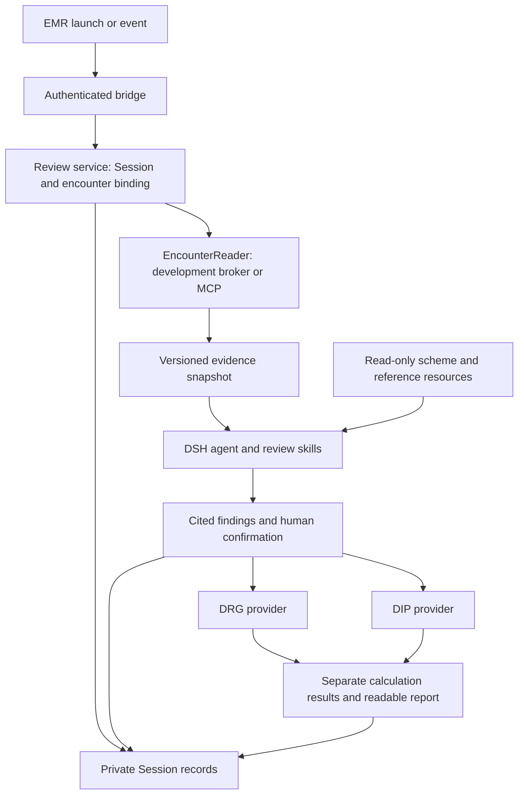

# 出院前核查：DRG／DIP 插件设计 V1

[English](drg-review-assistant-v1-plugins.md) | 中文

状态：完整 V1 设计，首阶段子集已通过本地验证，待用户验收，2026-10-22。用户已确认出院前核查、DRG／DIP 分别预分组及不阻断出院。首阶段包含就诊取数、提示性核查及浏览器入口；结构化人工确认和两种分组引擎仍属规划。下文接口描述完整目标，所链接的包 README 定义当前 API。[需求文档](drg-review-assistant-v1.zh.md)拥有产品范围与验收，[实施方案](drg-review-assistant-v1-implementation.zh.md)拥有顺序和已有部署证据。

## 概述

一个核查 agent（智能体）读取就诊证据、提出带引用的疑点、收集人工处置，并解释对应分组提供方的确定性结果。四类业务能力分别提供上下文／取证、资料、核查状态和计算。skill（技能）指导分析，代码强制校验权限、修订、确认及规则执行。临床原始记录仍由 EMR 管理，V1 不回写。

## 目录

- [插件职责](#plugins)
- [触发时机与调用顺序](#triggers)
- [上下文与数据流](#context)
- [业务工具与提示词](#tools)
- [DRG 与 DIP 计算](#grouping)
- [持久化、确认与恢复](#state)
- [EMR 取数提供方替换](#providers)
- [验证与未决依赖](#validation)
- [开发备注](#dev-note)

## 插件职责

下列名称是逻辑模块，不是已发布包名；仅在所有权或替换需要独立演进时拆包。现有资料存储是库，面向模型的读取能力还需插件消费方。[DSH 架构](../architecture.zh.md)定义 Service Definition、Service Provider 和 Consumer 三种角色，拟议可替换能力须具备全部角色。

| 能力 | 负责及提供 | 不负责 | 依赖与替换 |
| --- | --- | --- | --- |
| 就诊上下文与取证 | EMR 桥接验证启动身份、来源标识、事件 ID 及允许就诊；EncounterReader 服务返回原始记录和覆盖情况。桥接向核查服务申请绑定。 | 不另存一套病例状态，不负责分组规则或临床确认，不把数据库凭据交给模型。 | 读取服务定义独立于桥接；有界开发取数与未来 MCP 适配器实现该定义。核查服务依赖定义，不依赖提供方内部实现。 |
| 医保资料与版本 | 解析并校验明确的方案／资料绑定，按稳定标识读取有界原文、编码字典和已复核规则。 | 不保存患者记录，不猜适用模式，不允许 agent 工具发布资料或模型生成规则。 | 复用仅含来源的 DRG 归档；另加 DIP 版本资料及已复核可执行产物。资料工具消费读取服务。 |
| 核查与人工确认 | 拥有 Session／就诊绑定、证据快照、疑点、人工处置、各模式编码快照、操作回执和结果记录，提供业务工具及可读报告。 | 不执行任意 SQL，不使用提供方身份捷径，不修改临床原记录，不声称医保批准。 | 消费取数／资料／计算服务定义；复用持久插件记录、Session 投影及根交互服务。 |
| 预分组计算 | 计算服务分别注册 DRG 与 DIP 提供方，各自校验有类型输入和兼容资料，返回各自确定性结果。 | 不取原始病例、不调用模型、不授予患者权限、不自动确认、不计算支付金额。 | 业务工具消费计算服务，纯计算库实现提供方；外部引擎适配须另行核实版本／输入语义。 |

四类能力不要求四个 agent。使用既有工具、[skill](../../packages/skill/tool-skill/README.zh.md)、[人工提问](../../packages/interaction/user-questions/README.zh.md)及 Session 服务组合一个可选核查 preset，通用 DSH 工具沿用既有策略。临床凭据和更大患者访问范围留在受控服务端读取器，命令工具不能通过读取共享凭据绕过患者限制。

核查服务按私有运行实例及 Session 保有唯一业务状态，作用域工具从实际 Host／Agent 取得身份，模型不能选择。preset 本身不会自动隔离 Cordis 服务：须显式以 Session 键控，或把完整提供方／消费方组放在同一隔离域。通用网关提供已认证运行实例路由，就诊授权和临床状态分别由独立 broker 与核查插件负责。

## 触发时机与调用顺序

下列触发名称是拟议集成事件，不是已核实的 EMR 事件名。手动核查和已认证外部事件进入同一核查服务。每条事件携带稳定事件 ID 与来源修订，按调用方、就诊、触发类型和修订持久去重；不同事件若输入未变，复用进行中的任务或已记录结果。

| 时机 | 服务端动作 | 模型行为 | 结果 |
| --- | --- | --- | --- |
| 打开患者 | 验证启动并绑定／打开就诊专属 Session，仅发布身份及覆盖元数据。 | 不唤醒，不自动完整分析。 | 展示正确患者／就诊及适用方案。 |
| 主动核查或已配置出院医嘱事件 | 验证事件、权限及来源修订，记录核查请求并取得证据快照。 | 唤醒一个核查轮次，先看目录，再读取相关证据／规则。 | 异步返回疑点及覆盖情况。 |
| 草稿生成或修改 | 取得实际可读草稿和修订，保留未签署状态，使受影响结论失效。 | 在明确请求或配置事件下复核该修订。 | 用原始证据核对草稿，生成不等于先前批准。 |
| 人工处理疑点与编码 | 固定模式快照并展示服务生成的确认请求。 | 解释缺项，等待实际回答。 | 已提交回执仅确认这一份计算输入。 |
| 确认输入齐备 | 检查当前修订／资料后调用对应提供方。 | 解释返回结果，不改写编码或分值。 | 分别展示 DRG 或 DIP 结果及依据。 |
| 来源变化、切换患者或重试 | 标记受影响结果失效，尽可能取消被替代工作，并在发布前复核修订。 | 仅在授权触发下重核，不沿用其他患者上下文。 | 迟到结果仅作历史，重试不能重复产生确认。 |

使用 [agent.followup()](../../packages/core/agent/README.zh.md)排队并唤醒已接受核查请求；agent.inject()只向后续接纳的请求补上下文，不启动分析。调用前先持久保存业务绑定，inject 不是绑定存储。不另建 agent loop（智能体循环），也不把[workflow 插件](../../packages/workflow/workflow/README.zh.md)当作持久临床状态机。

EMR 出院事务不等待模型、取数、人工确认或分组器。集成单独展示核查状态，超时表示核查未完成，不表示检查成功。核查入队失败不得改变原出院响应；切换患者改变界面展示的 Session，不改变既有 Session 绑定的就诊。

## 上下文与数据流

分别传递可信执行身份、共同临床证据和各模式计算配置。认证令牌及患者查询权限留在服务端；模型只接收不透明就诊引用、有界来源内容及解释疑点所需信息。所有新增模型可见内容都记录到 Session 历史。

| 记录及所有者 | 必要信息 | 传递与校验 |
| --- | --- | --- |
| 启动请求：EMR 桥接 | eventId、trigger、sourceSystem、医院／院区提示、inpatId、可用的 inpatCode／sourceVisitId、documentId／revision 及启动授权引用。 | 浏览器字段仅为待验证声明；服务端验证调用方并映射标识后申请 Session 绑定，URL 不放 bearer token。 |
| 执行上下文：可信后端 | 已认证账号／医生映射、租户／医院、允许就诊及操作、私有实例／Session、requestId、截止时间、取消及访问授权引用。 | 从已认证配置／调用方取得，不来自模型参数；令牌只在服务端短期保管，恢复时重新获取授权。 |
| 就诊绑定：核查服务 | bindingId、caseRef、encounterRef、来源系统及已验证标识映射、Session 身份和绑定修订。 | 一个 Session 对应一次就诊。inpatId、住院号及下游 visitId 在明确映射前属于不同命名空间，冲突时停止取数。 |
| 证据快照：核查服务接收读取结果 | caseRevision、cutoff、capturedAt、来源 ID／修订／摘要、临床事件及资料可用时间、原始值、来源状态、单位及各类覆盖情况。 | 持久保存不可变的已接受快照，读取使用该修订；区分缺失、待出、未读、不支持及不一致资料。 |
| 方案绑定：资料服务解析、核查服务保存 | mode、地区、填报对象、生效时间、方案／包修订、字典／映射身份、适用分值表身份及兼容引擎版本。 | 可信配置为就诊选择方案，国家演示规则明确标识；地方规则缺失时不得静默回退国家规则。 |
| 模式快照：核查服务 | modeRevision、snapshotId、证据修订、主次诊断及操作编码、适用属性、问题处置、方案绑定和输入摘要。 | DRG 与 DIP 清单分别保留；人工确认绑定完整快照，计算工具接收其标识，不接收重写输入。 |
| 结果：核查服务 | 模式、快照／摘要、资料及引擎身份、状态、疑点、覆盖、缺项、引用、计算数据和限制。 | 比对预期修订后拒绝过时发布，可读报告与有类型结果使用同一已提交结果 ID。 |

先取小型资料目录，再读相关原文片段。目录包含来源状态和明确取数缺口；没有读取某记录不证明其不存在。大结果按已校验部署限值分页，保留完整快照目录及稳定游标，不静默截断证据；提供方无法保持跨页修订一致时，将快照标为不一致，确认前须刷新。

可选手动导入只接收合成消息。粘贴内容在导入工具运行前已经对模型可见，导入校验不能保护更早请求；此类测试输入须符合模型预算，超限使用原生请求错误。已授权提供方响应须在任何患者片段注入前完成校验及限量。

编辑器草稿与数据库已签署记录是不同来源；生成通知或时间戳不是内容修订。须取得实际正文及来源修订或摘要，保留草稿／签署状态，不能用旧草稿响应满足新请求。资料在截至时点后才可用时，即使描述更早事件，也只能进入新快照。

公共资料可以跨用户和会话共享，患者证据、确认和结果不可以。刷新及确认通过可用来源修订复核新鲜度，不假定实时同步；报告展示证据采集时间及无法刷新的来源。

## 业务工具与提示词

以下是拟议工具名。作用域工具先校验模型 JSON，再按当前绑定校验来源归属、修订及权限；标识通过 schema 校验不表示获得访问权限。工具接收不透明引用，不接收自由患者选择器、SQL、任意路径／URL 或凭据。

| 工具 | 模型输入 | 服务行为与输出 |
| --- | --- | --- |
| review_load_case | 可选刷新意图，或可导入的已记录合成消息引用。 | 解析已授权当前绑定，取得／校验病例包，固定 caseRevision，返回目录、方案及缺口。 |
| review_read_evidence | sourceRef、caseRevision 及有界位置／游标。 | 返回已接受快照的原文片段和精确引用，拒绝其他归属或过时引用。 |
| insurance_read_reference | mode、已绑定包引用、查询或规则／编码 ID。 | 返回带版本和页／行引用的原文规则／字典依据，搜索只排列候选，不改变分组判定。 |
| review_submit_findings | 预期修订、候选事实、附字典引用的模式编码／角色、疑点、引用及处置建议。 | 校验引文／编码和已支持检查，生成 draftId 及该模式不可变 snapshotId；候选编码与处置不算人工决定。 |
| review_confirm_snapshot | 当前 snapshotId 与 mode。 | 展示服务自持内容并记录已认证人工回答；接受才确认该快照，更正、暂缓或附理由排除则形成新草案／修订，须重新确认。 |
| insurance_pre_group | 已确认 snapshotId 与 mode。 | 读取不可变确认输入，检查就绪状态及当前修订，调用 DRG 或 DIP，持久记录精确结果。 |
| review_get_report | 可选当前结果 ID。 | 返回当前或明确标记历史的报告、证据链接、覆盖、处置及独立计算状态。 |

一份共用核查 skill 说明取证顺序、医嘱与执行区别、引用要求、不确定性及确认时机；DRG 模式 skill 说明必要分组字段和返回路径，DIP 模式 skill 说明病种／操作组合及匹配依据。按需加载对应模式资料，患者特定正文不进入全局系统提示词或共享 skill。

skill 不能授予权限、固定版本、批准编码或计算权威病组。缺资源时计算明确不可用，独立证据检查仍可继续；仅由模型提出的候选标为未计算。向量检索可后续增强资料搜索，精确编码查询与可执行分组仍使用版本化确定性数据。

首版 Web 使用可读工具结果及既有提问界面，展示患者／就诊、截至时点、方案、带来源链接的疑点、未核查覆盖及独立 DRG／DIP 状态。后续专用卡片需要注册 Client 渲染器，只有 Host 展示转换器不会自动产生 Web 卡片；运行、空态和错误文案由本地化字典拥有。

## DRG 与 DIP 计算

两种提供方均消费从共同临床证据形成的确认编码快照，共用外层结果字段，不强行使用相同临床输入或结果 schema。选定版本定义确切必需字段，未知数据不能变成零、无疾病或已完成治疗。

| 内容 | DRG 提供方 | DIP 提供方 |
| --- | --- | --- |
| 模式输入 | 主诊断与其他诊断、带角色操作，以及适用年龄、性别、出生体重、离院结局等规则属性。 | 主诊断、适用操作组合、其他诊断及规则属性；费用／天数／结局仅按选定规则需要纳入。 |
| 规则 | 选定完整国家分组路径、优先、排除及特殊处理，CC／MCC 分类不由模型生成。 | 选定病种目录、组合匹配、优先／综合路径及明确支持调整，不将地方导出公式当作国家规则。 |
| 结果 | 病组编码／名称及适用 MDC／ADRG／DRG 路径、采用字段与规则、歧义或无法入组。 | 病种编码／名称、命中诊断／操作组合及规则路径；仅有兼容且身份明确的分值资源时返回分值和调整。 |
| 资料不可用 | 没有已激活完整包，就不能给出经验证病组。 | 病种匹配和分值计算分别判定就绪，命中病种不表示已知分值。 |

共同输出包括 mode、输入与确认身份、病例／模式修订、规则／字典／引擎身份、status、missingFields、evidence 和 limitations。DRG 与 DIP 结果使用各自判别字段。调用成功可以返回无法入组或歧义，不保证得到病组；V1 不将病组／分值换算为支付或盈亏。

各提供方分别记录就绪状态及独立复核验收集。DIP 不可用不使有效 DRG 结果不可用，DRG 也不能替代 DIP。完整 DRG 引擎目标保留；DIP 完整性须在实现验收前绑定明确版本。

## 持久化、确认与恢复

核查服务拥有绑定及全部已接受修订。拟议实验实现使用版本化 [appendPluginRecord](../../packages/core/session/README.zh.md)记录及 [Session 投影](../../packages/session/session-projection/README.zh.md)，不向 SessionHeader 或 agent 创建元数据随意添加患者字段。每条已提交状态记录描述完整业务后状态，并稳定引用不可变证据记录；投影折叠保持同步、纯函数，不查询 EMR 或持有凭据。

插件记录不会自动成为模型上下文。可读证据／疑点／结果通过已记录工具内容或被接纳的注入消息进入模型，精确结构化状态另行提交。工具规范返回值不会自动持久化，服务须显式记录恢复所需字段。遇未知记录 schema 或投影语义时停止依赖操作，不使用部分状态；未来改为非实验事件类型须完成仓库持久化评审及消费者更新。

确认绑定已认证回答人、Session、就诊、病例／模式修订、快照摘要、规则绑定及一次性请求 ID。服务展示自持固定值，只接受对应人工回答；普通工具许可或模型参数均不充分。复用[仅根 agent 可用的交互](../../packages/interaction/user-questions/README.zh.md)，委派／subagent 调用返回 awaiting_confirmation，须经已认证人工通道续接。

不假定待答自定义问题能够跨进程重启续答。取消、根交互不可用或持久回答前丢失时快照保持未确认；明确恢复后复核修订，再构造新请求。模型拟议处置须展示供人工接受，不得静默记成医生决定。

人工编码更正通过服务持有的问题或已认证结构化界面回调提交，保留原始回答。自由文字只能形成编码候选；须校验字典引用、生成修订快照，再展示确切字段供重新接受。暂缓且尚未解决的必要条件保持未确认。

每个 Session 串行提交变更，在确认及结果发布前比对预期修订。追加操作 ID 和完整结果后，等待 ctx.sessions.flush(session) 或等效持久确认，再签发已接受回执或允许计算。append 是带异步落盘的内存提交，flush 失败可能已有部分数据持久化；应停止依赖操作，显示持久化未确认，恢复时核实同一操作 ID，不能声称已回滚或重复确认。确认持久成功后，丢失的工具响应可从已提交操作恢复。

共同证据、截至时点或人工对共同临床事实解释的更正递增 caseRevision，并使两种模式失效，即使来源字节未变也如此。只有模式专属编码、规则绑定或仅涉及该模式的疑点处置才单独递增 modeRevision。发布默认版本不改变固定绑定，显式改绑才改变；发布前复核撤回／就绪状态，失败或被替代工作不覆盖较新已接受状态。

恢复同一 Session 时重建证据／历史，在新读取或计算前重验当前权限及来源／资料新鲜度。分叉历史只能展示原就诊旧报告；继续业务须在新 Session 重新授权绑定、取证和确认，其他就诊须使用无继承历史的空 Session。子会话不能继承有效授权／确认，报告状态不是临床资质或医保决定。

核查状态区分 collecting、reviewing、awaiting_human、reviewed、stale、failed 和 cancelled；计算状态独立区分 awaiting_confirmation、needs_input、unavailable、running、grouped、ambiguous、ungroupable、failed 和 stale。已核查仍可能有未决疑点或不可用计算，不能用统一绿色通过暗示全部临床正确。

## EMR 取数提供方替换

开发读取器位于受控后端，使用只读数据库权限、参数化固定查询、有界输出及明确授权的就诊白名单。用户工作区仅取得就诊范围内的能力，不取得数据库凭据。每次调用重验调用方及允许就诊，请求自带 doctorId 或 hospitalCode 不构成授权。

试用通过已认证工作区接收手动或受信窗口的标识声明，并依据 broker 就诊白名单核对 SSO 身份；浏览器 origin 校验不授予患者访问权。后续医院 EMR 启动由已认证后端请求换取短期一次性启动引用，绑定人员、就诊、目标和有效期。签发方、账号映射及传输仍为集成依赖，查询字符串 inpatId 或无限制浏览器 postMessage 不能替代。现有公司 SSO 提供身份，不提供 EMR 取数令牌。

| 来源类别 | 首轮读取与映射 | 缺口处理 |
| --- | --- | --- |
| 就诊与基本信息 | 解析医院范围内 inpatId／住院标识及事件时间。 | 映射冲突时拒绝，未知基本属性原样保留。 |
| 诊断与操作 | 临床原记录与编目编码分开，核实后将 EMR 编码集合映射到对应模式。 | 第二套模式记录不能等同于次要诊断。 |
| 文书与报告 | 读取来源目录及原文，保留文书状态、修订和可用时间。 | 缺草稿适配或报告入口时明确缺口，不以摘要替代。 |
| 医嘱与执行 | 读取医嘱意图／状态及可取得的独立执行证据。 | 医嘱过程元数据、收费或计划结束时间不能证明执行。 |

未来 MCP 适配器将有类型读取请求转换为公司工具调用并校验响应。[DSH MCP](../../packages/mcp/mcp-client/README.zh.md)支持传输及工具发现，但配置请求头不会自动委派当前医生身份。能绕过读取限制的原始发现工具不得直接加入临床组合，或由 MCP 服务端自身实施相同限制。两种提供方须保持来源 ID／修订、覆盖、分页一致性、取消及拒绝访问语义。

既有 EMR 实现是取证入口，不是完整分组服务：DRG 导出链组装文件，DIP 导出含地方预测逻辑，部分质检入口调用外部服务。导出成功不能证明国家规则完整。映射实现前须对所选开发后端修订核查数据库字段及实际部署行为。

## 验证与未决依赖

[验收表](drg-review-assistant-v1.zh.md#acceptance)拥有用户可观察行为。集成测试还须覆盖每次传递：伪造人员／就诊标识、来源修订冲突、确认响应丢失、提供方迟到结果、独立模式更新、恢复／分叉、数据库与 MCP 测试提供方同输入，以及全部核查依赖失败时出院仍完成。

临床集成前须落实指定允许的病例 ID、可信启动签发方及 SSO 到 EMR 的身份映射、实际 EMR 触发／草稿读取机制、来源状态及执行映射。计算验收前须落实各模式确切规则／字典版本、DIP 分值范围和独立专业基准负责人。这些依赖不妨碍评审本设计或实现合成约定测试。

首阶段可验证证据核查并明确标记计算不可用，这不构成完整 DRG 或 DIP 引擎验收。用户分别验收疑点是否有用、是否不阻断出院、各模式分组和隐私隔离；模型成功响应、PDF 归档或文档检查均不能单独证明这些临床结果。

## 开发备注

设计沿用 2026-10-22 已确认定位。首个实现子集包含 [emr-encounter](../../packages/experimental/emr-encounter/README.zh.md)、[emr-reader-broker](../../packages/experimental/emr-reader-broker/README.zh.md)、[clinical-review](../../packages/experimental/clinical-review/README.zh.md) 和 [client-emr-entry](../../packages/experimental/client-emr-entry/README.zh.md)。本方案其余插件职责仍属规划，实施文档维护进度及验证。
